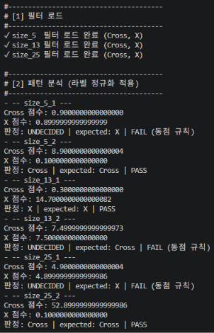
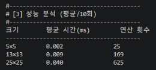
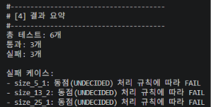

# Mini NPU Simulator

## 1. 프로젝트 소개

### 1-1. 프로젝트 목적
본 프로젝트는 AI 연산의 핵심 원리 중 하나인 MAC(Multiply-Accumulate) 연산을 Python으로 직접 구현하고, 입력 패턴과 필터 사이의 유사도를 계산하는 Mini NPU 시뮬레이터를 개발하는 것을 목적으로 한다.

3×3부터 25×25까지 다양한 크기의 패턴을 처리하고, Cross와 X 필터의 연산 점수를 비교하여 입력된 패턴을 판별한다.

또한 데이터 크기에 따른 연산 시간의 변화를 측정하고, MAC 연산의 시간 복잡도를 분석한다.


### 1-2. 개발 환경
 - 개발 언어: Python 3.12.10
 - 사용 라이브러리: json, os, time 표준 라이브러리
 - 외부 라이브러리: 사용하지 않음
 - 실행 파일: main.py
 - 데이터 파일: data.json


## 2. 실행 방법

### 2-1. 프로그램 실행
```bash
$ python main.py
```


### 2-2. 실행 모드
프로그램 실행 후 원하는 모드를 선택한다.

#### (1) 사용자 입력 (3X3)
 - 필터 A, B 입력
 - 입력 패턴 입력
 - MAC 점수 계산 및 판정 결과
 - 연산 시간 측정

#### (2) data.json 분석
 - JSON 파일에서 필터와 패턴 불러오기
 - 패턴별 MAC 점수 계산
 - Cross / X / UNDECIDED 판정
 - expected 값과 비교하여 PASS / FAIL 출력
 - 크리별 성능 분석 및 결과 요약


## 3. 구현 내용

### 3-1. 데이터 구조

패턴과 필터는 2차원 리스트를 사용하여 저장하였다.
각 배열은 N×N 형태로 구성되며, 3×3, 5×5, 13×13, 25×25 크기의 데이터를 처리할 수 있도록 구현하였다.

### 3-2. MAC 연산 구현
MAC 연산은 입력 패턴과 필터의 동일한 위치에 있는 값을 각각 곱한 후, 모든 결과를 더하는 방식으로 구현하였다.
외부 라이브러리(NumPy)를 사용하지 않고 중첩 반복문을 통해 구현하였다.

```bash
def mac(pattern, filter_data):

    score = 0.0   # 점수를 저장할 변수
    n = len(pattern)    # 배열의 크기 확인
    for i in range(n):  # 행(가로) 반복
        for j in range(n):  # 열(세로) 반복
            score += pattern[i][j] * filter_data[i][j]  # pattern[i][j] = 입력 패턴의 숫자 / score += ... = 곱한 값을 점수에 누적
    return score    # 최종 점수 반환
```

### 3-3. 라벨 정규화
JSON 파일에 저장된 라벨과 프로그램 내부에서 사용하는 라벨이 다를 수 있으므로 라벨 정규화 기능을 구현하였다.

|입력 라벨|표준 라벨|
|:---|:---|
|+|Cross|
|cross|Cross|
|x|X|

이를 통해 대소문자나 기호 차이로 인해 발생하는 잘못된 판정을 방지하였다.
프로그램 내부에서는 Cross와 X 두 가지 표준 라벨만 사용하도록 하였다.

### 3-4. 부동소수점 오차 및 동점 처리
실수 연산에서는 부동소수점 오차가 발생할 수 있다.
따라서 두 필터의 점수를 단순히 비교하지 않고 epsilon 값을 활용하여 동점 여부를 판단하였다.

```bash
def classify(score_a, score_b, label_a="A", label_b="B"):
    EPSILON = 1e-9  # EPSILON = 0.000000001
    diff = abs(score_a - score_b)   # abs = 절댓값을 구하는 함수
    if diff < EPSILON:
        return "UNDECIDED"  # 두 점수의 차이가 EPSILON보다 작으면 결과를 결정하지 않겠다.
    if score_a > score_b:
        return label_a
    else:
        return label_b
```
두 점수의 차이가 1e-9보다 작으면 동점으로 처리하고, 그렇지 않으면 더 높은 점수를 가진 필터를 선택하도록 구현하였다.

### 3-5. JSON 데이터 처리 및 예외 처리
data.json 파일에서 필터와 패턴 데이터를 불러오도록 구현하였다.
패턴의 키 이름에서 크기 N을 추출하고, 해당 크기에 맞는 필터를 선택하도록 하였다.
또한 다음과 같은 오류 상황을 고려하였다.

#### (1) 필터와 패턴의 크기가 일치하지 않는 경우
```bash
row = input().split()

if len(row) != n:   # 입력한 한 행의 숫자 개수가 행렬의 크기와 일치하는지 확인
    raise ValueError    # 숫자의 개수가 맞지 않으면 오류를 발생시
```

#### (2) JSON 데이터의 필수 키가 누락된 경우
```bash
filters = data.get("filters", {})   # JSON에 filters 키가 없으면 빈 딕셔너리 {}를 반환함
patterns_dict = data.get("patterns", {})    # JSON에 patterns 키가 없으면 빈 딕셔너리 {}를 반환


pattern = case_info.get("input")    # input 키가 없으면 None을 반환함
expected = normalize_label(case_info.get("expected", ""))   # expected 키가 없으면 빈 문자열 ""을 반환함
```

#### (3) 올바르지 않은 라벨이 입력된 경우
```bash
def normalize_label(label):
    label = str(label).strip().lower()

    if label in ["+", "cross"]:
        return "Cross"  # "+", "cross"가 입력되면 "Cross"로 변환함

    if label == "x":
        return "X"  # "x"가 입력되면 "X"로 변환함

    return "UNDECIDED"  # 그 외의 올바르지 않은 라벨이 입력되면 "UNDECIDED"를 반환함
```

#### (4) 데이터의 배열 구조가 올바르지 않은 경우
```bash
row = input().split()

if len(row) != n:   # 한 행에 필요한 숫자가 있는지 검사
    raise ValueError

row = list(map(float, row)) # 입력된 데이터가 숫자로 변환 가능한지 검사
matrix.append(row)  # 검증이 끝난 행을 행렬에 추가

```
오류가 발생한 경우 프로그램 전체가 종료되지 않도록 해당 케이스를 FAIL로 처리하고 실패 원인을 출력하도록 하였다.


## 4. 테스트 결과

### 4-1. 사용자 입력 모드 테스트
3×3 Cross 필터와 X 필터를 입력하고, 테스트 패턴을 사용하여 MAC 연산이 정상적으로 수행되는지 확인하였다.

|항목|결과|
|:---|:---|
|Cross 필터 입력|정상|
|X 필터 입력|정상|
|패턴 입력|정상|
|MAC 점수 계산|정상|
|판정 결과 출력|정상|

실제 실행 결과:


### 4-2. JSON 데이터 분석 테스트

data.json에 저장된 5×5, 13×13, 25×25 크기의 패턴을 불러와 판정 결과를 확인하였다.

|테스트 항목|결과|
|:---|:---|
|5×5 패턴 분석|PASS 1개 / FAIL 1개|
|13×13 패턴 분석|PASS 1개 / FAIL 1개|
|25×25 패턴 분석|PASS 1개 / FAIL 1개|
|expected 비교|정상|
|결과 요약 출력|정상|

총 6개의 패턴을 분석한 결과 3개가 PASS, 3개가 FAIL로 나타났다.
FAIL이 발생한 세 가지 케이스는 두 필터의 점수 차이가 epsilon(1e-9)보다 작아 UNDECIDED로 판정된 경우였다. 따라서 expected 값과 실제 판정 결과가 일치하지 않아 FAIL로 처리되었다.




### 4-3. 예외 상황 테스트

|테스트 상황|예상 동작|실제 결과|
|:---|:---|:---|
|행 개수 불일치|오류 안내 후 재입력|입력 행의 숫자 개수가 맞지 않으면 오류 안내 후 재입력|
|열 개수 불일치|오류 안내 후 재입력|한 행의 숫자 개수가 N개가 아니면 오류 안내 후 재입력|
|숫자 파싱 실패|오류 안내 후 재입력|숫자로 변환할 수 없는 값 입력 시 ValueError 발생 후 재입력|
|필터와 패턴 크기 불일치|해당 케이스 FAIL|JSON 모드에서 별도 크기 검증 기능은 구현되지 않음|
|점수 차이가 epsilon 미만|UNDECIDED 판정|정상적으로 UNDECIDED 판정|


## 5. 결과 리포트

### 5-1. 전체 테스트 결과
실제 프로그램 실행 결과를 바탕으로 전체 테스트 결과를 정리하였다.
 - 전체 테스트 수: 6개
 - 통과한 테스트 수: 3개
 - 실패한 테스트 수: 3개

|케이스 이름|expected|실제 판정|실패 원인|
|:---|:---|:---|:---|
|size_5_1|X|UNDECIDED|두 점수의 차이가 epsilon 미만|
|size_13_2|Cross|UNDECIDED|두 점수의 차이가 epsilon 미만|
|size_25_1|X|UNDECIDED|두 점수의 차이가 epsilon 미만|




### 5-2. 실패 원인 분석
프로그램을 구현하고 테스트하는 과정에서 발생한 문제를 데이터 문제, 로직 문제, 수치 비교 문제로 구분하여 분석하였다.

#### (1) 데이터 및 스키마 문제
JSON 파일의 키 이름이나 라벨 형식이 프로그램에서 예상하는 구조와 다르면 데이터를 정상적으로 불러오지 못할 수 있다.  
이를 해결하기 위해 라벨 정규화 기능을 구현하고, 패턴 ID에서 크기를 추출하여 해당 크기에 맞는 필터를 선택하도록 하였다.  
또한 normalize_label() 함수를 통해 +, cross는 Cross로, x는 X로 변환하도록 하였다.  

#### (2) 라벨 문제
expected 값과 필터 키의 라벨 표현 방식이 서로 다르면 실제 결과가 맞더라도 비교 과정에서 FAIL이 발생할 수 있다.  
이를 방지하기 위해 '+', 'cross', 'x' 등의 값을 Cross와 X라는 표준 라벨로 정규화하였다.  

#### (3) 배열 크기 불일치 문제
필터와 패턴의 행 또는 열 크기가 서로 다르면 올바른 MAC 연산이 불가능하다.  
따라서 연산 전에 배열 크기를 검사하고, 크기가 일치하지 않는 케이스는 FAIL로 처리하도록 하였다.  

#### (4) 동점 처리 문제
두 필터의 점수가 같거나 허용오차 이내인 경우 어느 한쪽을 임의로 선택하지 않고 UNDECIDED로 판정하도록 하였다.  
따라서 expected가 Cross 또는 X인 경우에는 해당 테스트가 FAIL이 될 수 있다.

|구분|mode1|mode2|
|:---|:---|:---|
|사용 목적|사용자 입력 패턴 판정|JSON 테스트 데이터 분석|
|동점 기준|점수 차이 1e-9 미만|점수 차이 1e-9 미만|
|동점 결과|판정 불가 출력|UNDECIDED 출력|
|PASS/FAIL 집계|수행하지 않음|expected와 비교하여 집계|
|후속 처리|사용자에게 판정 결과 안내|FAIL 케이스에 포함|

#### (5) 부동소수점 및 비교 문제
컴퓨터의 실수 연산은 미세한 오차가 발생할 수 있다.  
단순히 두 점수의 크기만 비교하면 사실상 같은 점수임에도 서로 다른 결과로 판정될 수 있다.  
이를 해결하기 위해 epsilon 값을 사용하여 일정 범위 이내의 점수 차이는 동점으로 처리하였다.  
실제 테스트에서도 다음과 같은 결과가 나타났다.  

 - size_5_1: Cross = 0.9000000000000000, X = 0.8999999999999999
 - size_13_2: Cross = 7.4999999999999973, X = 7.5000000000000000
 - size_25_1: Cross = 4.9000000000000004, X = 4.8999999999999986

세 케이스 모두 점수 차이가 1e-9보다 작기 때문에 UNDECIDED로 판정되었다.  
이는 프로그램의 비교 정책에 따른 정상적인 동작이지만, expected 값이 Cross 또는 X로 지정되어 있었기 때문에 최종 테스트에서는 FAIL이 발생하였다.  

#### (4) 최종 분석
이번 테스트에서는 총 6개 케이스 중 3개가 통과하고 3개가 실패하였다.  
실패한 세 케이스는 MAC 연산 자체의 오류가 아니라 epsilon 기반 동점 처리 규칙에 의해 발생하였다.  
따라서 현재 프로그램은 두 점수의 차이가 매우 작은 경우 잘못된 우열 판정을 방지하도록 정상적으로 동작하고 있음을 확인하였다.  
다만 expected 값과 UNDECIDED 판정이 일치하지 않는 경우 FAIL이 발생하므로, 데이터의 정답 라벨과 동점 처리 정책을 함께 고려할 필요가 있다.  

### 5-3. 성능 측정 결과
각 크기의 패턴에 대해 MAC 연산을 10회 반복 수행하고 평균 시간을 측정하였다.  

|패턴 크기|연산 횟수 (N²)|평균 연산 시간 (ms)|
|:---|:---|:---|
|3×3|9|미측정|
|5×5|25|0.002|
|13×13|169|0.009|
|25×25|625|0.040|

### 5-4. 시간 복잡도 분석
MAC 연산은 N×N 크기의 패턴과 필터를 비교하기 위해 모든 위치의 값을 한 번씩 곱하고 더한다.  
따라서 전체 연산 횟수는 다음과 같다.  
 - N × N = N²  
이를 통해 MAC 연산의 시간 복잡도는 O(N²)임을 알 수 있다.  
패턴 크기가 증가할수록 연산 횟수도 제곱에 비례하여 증가한다.  
예를 들어 3×3 패턴은 9번의 연산이 필요하지만, 25×25 패턴은 625번의 연산이 필요하다.  
이는 3×3 패턴보다 약 69.4배 많은 연산을 수행해야 한다는 의미이다.  
실제 측정 결과에서도 패턴 크기가 증가할수록 연산 시간이 증가하는 것을 확인할 수 있었다. 

 - 5×5: 0.002ms
 - 13×13: 0.009ms
 - 25×25: 0.040ms  
다만 실제 실행 시간은 CPU 성능, Python 반복문 실행 비용, 운영체제의 작업 상태 등에 따라 차이가 발생할 수 있다.  
이번 실험을 통해 데이터 크기가 커질수록 MAC 연산량이 증가하며, AI 연산에서 병렬 처리가 중요한 이유를 이해할 수 있었다.  

### 5-5. 1000×1000 대규모 데이터 처리 분석

#### (1) 연산 횟수 계산
1000×1000=1,000,000  
즉, 필터 하나와 패턴 하나를 비교할 때 100만 번의 곱셈과 누적 연산이 필요하다.  
Cross와 X 두 필터를 비교한다면 총 200만 개의 위치에 대한 MAC 연산을 수행한다.  

|패턴 크기|필터 1개당 연산 횟수|필터 2개 연산 횟수|
|:---|:---|:---|
|5×5|25|50|
|13×13|169|338|
|25×25|625|1,250|
|1000×1000|1,000,000|2,000,000|

#### (2) 메모리 사용량 예측
Python의 2차원 리스트에 실수형 데이터를 저장한다고 가정하면 1000×1000 행렬 하나는 대략 32MB 정도의 메모리를 사용할 수 있다.  

|데이터|예상 메모리|
|:---|:---|
|패턴 1개|약 32MB|
|Cross 필터|약 32MB|
|X 필터|약 32MB|
|합계|약 96MB|

 - Python 객체와 리스트의 메모리 구조를 기준으로 한 대략적인 추정치이며, 실제 사용량은 환경에 따라 달라질 수 있다. JSON 파싱 과정의 추가 메모리도 고려해야 한다.  

#### (3) 최적화 방안
 - NumPy 활용
 - 불필요한 데이터 복사 최소화
 - 대용량 JSON 처리 개선


## 6. 프로젝트를 통해 배운 점
이번 프로젝트를 통해 MAC 연산이 입력 데이터와 필터의 유사도를 계산하는 기본적인 방법이라는 것을 이해할 수 있었다.  
또한 2차원 배열을 활용하여 데이터를 저장하고, 반복문으로 직접 곱셈과 누적 덧셈을 수행하는 방법을 학습하였다.  
JSON 데이터를 불러오는 과정에서 데이터의 키와 라벨 형식이 일치해야 한다는 점도 알게 되었다.  
특히 라벨 정규화와 epsilon을 활용한 비교 방식을 통해 데이터 처리와 실수 연산에서 발생할 수 있는 오류를 줄이는 방법을 익혔다.  
마지막으로 패턴의 크기가 증가할수록 연산 횟수가 N²에 비례하여 증가한다는 것을 직접 측정하고 확인하였다.  
이를 통해 AI 모델에서 많은 양의 MAC 연산을 빠르게 처리하기 위해 NPU와 같은 병렬 연산 장치가 필요한 이유를 이해할 수 있었다.  

## 7. 결론
본 프로젝트에서는 Python을 이용하여 Mini NPU 시뮬레이터를 구현하였다.  
3×3 사용자 입력 모드와 JSON 데이터 분석 모드를 구현하였으며, Cross와 X 필터의 MAC 점수를 비교하여 패턴을 판별할 수 있도록 하였다.  
또한 라벨 정규화, 데이터 크기 검증, epsilon 기반 동점 처리 및 성능 측정 기능을 구현하였다.  
실험을 통해 패턴 크기가 증가하면 연산 횟수와 처리 시간이 증가한다는 점을 확인하였으며, MAC 연산의 시간 복잡도가 O(N²)임을 이해할 수 있었다.  
이번 과제를 통해 AI 연산의 기본 원리와 데이터 처리, 예외 처리 및 성능 분석 방법을 학습할 수 있었다.

